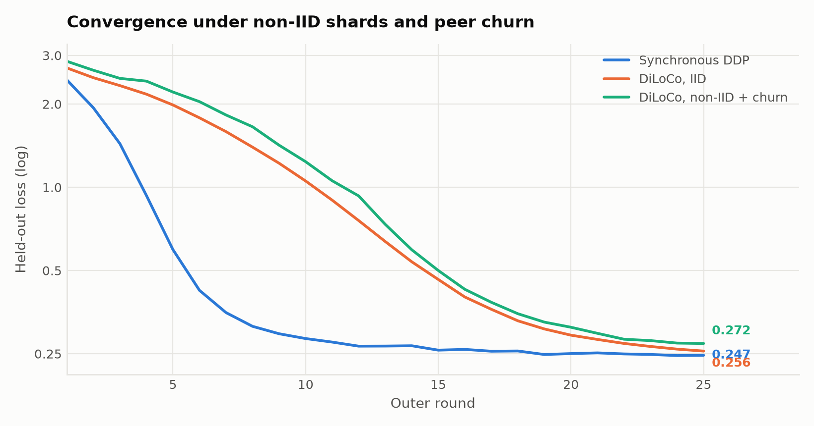
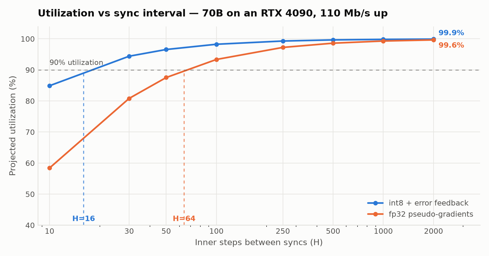

# dptrain

A working prototype of **decentralized low-communication training** — DiLoCo with
int8 transport, non-IID data shards, and peer churn, measured against a tuned
synchronous data-parallel baseline.

It runs real training: a small causal transformer with an AdamW inner loop and a
Nesterov outer loop over pseudo-gradients, across simulated peers that drop,
leave permanently, and join mid-run.

The point is to measure the **protocol**, not the laptop it runs on. Two
quantities are measured exactly and are hardware-independent — bytes on the wire
per parameter, and convergence against the baseline. Utilization is then
*projected* analytically for a device and link you specify, rather than inferred
from a Mac's wall clock, which would be meaningless.

---

## Benchmarks

6 peers · 25 outer rounds · H=40 inner steps · non-IID shards · int8 transport · churn on

| | |
|---|---|
| **Gap to perfect-network DDP** | **10.3%** (0.2723 vs 0.2468 held-out loss) |
| **Traffic vs naive synchronous DDP** | **80× less** at H=40 |
| **Cost of int8 compression** | **0.0 pts** — 4× smaller payload, free |
| **Peer-rounds lost to churn** | **8%** (8 drops, 2 permanent leaves) |

### Convergence

<picture>
  <source media="(prefers-color-scheme: dark)" srcset="docs/convergence-dark.png">
  
</picture>

DDP drops fast then flattens. DiLoCo descends more slowly but is still improving
at round 25 — the signature of outer-loop momentum needing more rounds, not a
quality ceiling.

### Ablations

Each row changes one thing against the full configuration.

| Ablation | Final loss | Gap to DDP | Isolated cost |
|---|---|---|---|
| Everything on (non-IID + churn + int8) | 0.2723 | 10.3% | — |
| IID shards instead | 0.2556 | 5.6% | non-IID costs **4.8 pts** |
| Churn disabled | 0.2614 | 5.9% | churn costs **4.4 pts** |
| fp32 instead of int8 | 0.2723 | 10.3% | compression costs **0.0 pts** |

Compression is free. Heterogeneity and churn each cost ~4–5 points and are
roughly additive.

### Utilization vs sync interval

<picture>
  <source media="(prefers-color-scheme: dark)" srcset="docs/utilization-dark.png">
  
</picture>

Error feedback is doing real work: **int8 reaches 90% utilization at H=16;
uncompressed fp32 needs H=64** — a 4× shorter sync window for a 2.3e-5 difference
in final quality.

Utilization is scale-invariant in model size here. Compute and payload both scale
linearly with parameters, so they cancel. That is specific to data-parallel
DiLoCo; pipeline parallelism behaves differently, because activations scale with
`d_model` while compute scales with `d_model²`.

**Read these as evidence the protocol survives adversity, not as numbers that
transfer to a 7B run.** This is a 0.8M-parameter model on a synthetic task over
25 rounds. The curve shape suggests DiLoCo had not converged; a longer run would
likely narrow the gap.

---

## Can a 24GB card join a run it can't hold?

The question DiLoCo can't answer: every peer needs a full replica, so the floor is
"train the whole model alone". Pipeline parallelism is the only way under that floor — each peer
owns a slice of layers and passes activations on.

`dptrain.pipeline` implements it for real. Activations are detached at each boundary, which severs
the autograd graph exactly as a machine boundary would, so the backward pass is walked stage by
stage. Gradients come out **bit-identical to monolithic autograd** at 2, 4 and 8 stages
(`verify_equivalence`, max delta 0.0e+00) — without that check the byte counts would describe a
model that trains differently from the one being claimed.

### Arithmetic intensity does scale with d_model

At a **fixed** stage count, boundary traffic grows with `d_model` while stage compute grows with
`d_model²`, so intensity should be linear in `d_model`. Measured, 4 stages, 8 layers:

| d_model | FLOP/byte | vs d_model=64 | ideal |
|---|---|---|---|
| 64 | 1,227 | 1.00× | 1× |
| 128 | 2,379 | 1.94× | 2× |
| 256 | 4,683 | 3.82× | 4× |
| 512 | 9,291 | 7.57× | 8× |

Essentially linear. Which suggests bigger models are more pipeline-friendly.

### But you cannot hold the stage count fixed

Training state costs ~14 bytes per parameter (bf16 weights, fp32 master, Adam m and v). A 24GB card
therefore caps a stage at ~1.7B parameters **regardless of how big the model is** — so stage count
is forced to scale with the model, and per-stage compute stays pinned near the memory budget while
boundary traffic keeps growing with `d_model`.

Projected on an RTX 4090, 110 Mb/s uplink, int8 activations, micro-batch 1×2048. Memory is counted
honestly — bf16 weights, bf16 gradients, the master copy, optimizer state, and activation memory
under a 1F1B schedule:

| Model | Memory config | Stages | B/param | Util | Island @95% | +2× redundancy |
|---|---|---|---|---|---|---|
| **7B** | fp32 Adam + fp32 master | 5 | 16.0 | 22.9% | 77.4% | 98.8% |
| | 8-bit Adam | 3 | 10.0 | 38.2% | 85.7% | 99.3% |
| | 8-bit Adam, no fp32 master | **2** | 6.0 | **57.3%** | 90.2% | 99.5% |
| **13B** | fp32 Adam + fp32 master | 9 | 16.0 | 19.1% | 63.0% | 97.8% |
| | 8-bit Adam, no fp32 master | 4 | 6.0 | 43.1% | 81.5% | 99.0% |
| | + ZeRO-1 across the island | **3** | 4.7 | **57.4%** | 85.7% | 99.3% |
| **70B** | fp32 Adam + fp32 master | 53 | 16.0 | 11.2% | 6.6% | 87.6% |
| | 8-bit Adam | 33 | 10.0 | 17.9% | 18.4% | 92.1% |
| | 8-bit Adam, no fp32 master | 20 | 6.0 | 29.5% | 35.8% | 95.1% |
| | + ZeRO-1 across the island | **14** | 4.1 | **42.2%** | 48.8% | 96.6% |

### The constraint was never bandwidth

Boundary traffic never changes across any row — it is fixed by `d_model` and sequence length. Every
gain comes from fitting more layers per card, which raises per-stage compute while the wire cost
stays flat.

So the binding constraint on decentralized pipeline training is **optimizer state**, not the
network. Cutting it from 16 to ~4 bytes per parameter roughly triples utilization and takes a 70B
from 53 stages to 14.

Two 4090s can train a 7B at 57% utilization. A 70B needs 14 cards at 42%, or 28 with the stage
redundancy its 48.8% island uptime demands.

### Measured: what low-memory states actually cost

The projection above assumed 8-bit moments and a dropped fp32 master were viable. Both are
numerical-precision questions, so they reproduce at toy scale. `dptrain.lowmem` implements them
from scratch — blockwise int8 moments (second moment held in sqrt space, since it spans orders of
magnitude and linear int8 across that range is useless) and bf16 masters with optional stochastic
rounding. Single-worker training, 600 steps, mean of 3 seeds:

| Optimizer state | B/param | Quality vs fp32 | Verdict |
|---|---|---|---|
| fp32 Adam + fp32 master | 16 | — | baseline |
| int8 Adam + fp32 master | 10 | **+0.11%** | free |
| int8 Adam + bf16 master, nearest rounding | 6 | **+12.35%** | broken |
| int8 Adam + bf16 master, stochastic rounding | 6 | **+0.14%** | free |

So the memory reduction behind the pipeline result is real — **16 → 6 bytes per parameter for about
a tenth of a percent of quality** — but stochastic rounding is load-bearing, not a detail.

The mechanism is visible without training anything. bf16 is the top 16 bits of fp32, so truncation
rounds toward zero and any update smaller than one ULP of the weight disappears. Applying a 1e-6
update to random weights:

| Rounding | Updates that survive |
|---|---|
| nearest (truncation) | **0.1%** |
| stochastic | **33.3%** |

Get this wrong and training does not crash — it quietly converges 12% worse.

### What this does not model

- **8-bit Adam has a small quality cost** that none of these numbers capture.
- **Dropping the fp32 master needs stochastic rounding**, or bf16 updates silently stall.
- **ZeRO-1 adds a gather per optimizer step** whose communication cost is not modelled here.

So treat the optimized rows as an **upper bound**. The direction is solid; the exact numbers are
optimistic.

---

## Install

```bash
uv venv --python 3.11 .venv
uv pip install --python .venv/bin/python torch numpy matplotlib
```

## Run

```bash
.venv/bin/python -m dptrain.run --peers 6 --rounds 25 --inner-steps 40

./sweep.sh                                              # all four ablations
.venv/bin/python -m dptrain.report                      # consolidate to summary.json
.venv/bin/python -m dptrain.plot results/summary.json docs   # regenerate charts
```

Useful flags:

```
--iid                 uniform shards instead of non-IID (85% own dialect)
--no-compress         fp32 pseudo-gradients instead of int8 + error feedback
--drop-prob 0 --leave-prob 0 --join-prob 0    disable churn
--uplink-mbps 110 --rtt-ms 80                 link model
--device-preset rtx4090|a100|h100|b200
--project-params 7e9                          model size to project for
```

## Layout

| File | Role |
|---|---|
| `model.py` | Tiny causal transformer; `flops_per_token()` drives the projection |
| `data.py` | Synthetic multi-dialect corpus; non-IID sharding (peer *k* gets 85% dialect *k*) |
| `diloco.py` | Inner/outer loop, int8 quantization with error feedback, outer Nesterov |
| `netsim.py` | Churn model, link model, utilization projection and inner-step sweep |
| `run.py` | CLI; runs DiLoCo and the baseline, writes a JSON report |
| `report.py` | Consolidates ablation reports into `summary.json` |
| `plot.py` | Renders the README charts, light and dark |

## Design notes

**Pseudo-gradient.** After *H* inner steps, peer *k* sends `theta_outer - theta_k`
— the displacement its local training produced. Those are averaged and handed to
the outer optimizer as if they were a gradient.

**Error feedback.** The int8 quantization residual is retained per peer and added
to the next round's payload, so compression error is deferred rather than
discarded. Dropping this term is the usual cause of a quality gap that only shows
up after many rounds.

**Churn.** Peers may miss a round, leave permanently, or join mid-run (a joiner is
initialized from the current outer weights). If every peer drops in a round, the
outer weights stand unchanged rather than erroring.

**The baseline is deliberately strong.** It is a fully synchronous data-parallel
equivalent — what the same peers would achieve over a perfect network — matched on
both total tokens and optimizer steps (effective batch `batch_size × n_peers`),
and run at two learning rates with the better kept. An earlier version used a
single worker at `batch_size`, which handed the baseline 1/K of the compute and
made DiLoCo look *better* than centralized training. It is not.

**Untied embeddings.** `tok.weight` and `head.weight` are deliberately *not* tied.
The outer state is round-tripped as a flat dict, and two keys aliasing one
Parameter silently corrupts it — the second `load_state_dict` assignment wins and
the copies diverge.

## Known limits

- Peers run sequentially on one machine. Wall-clock here is not a throughput
  measurement; that is what the projection is for.
- Data-parallel only. Sub-replica participation — a 24GB card joining a 70B run —
  is not implemented, and is the genuinely hard part.
- No verification, attestation, or settlement. Every peer is assumed honest.
- The synthetic task may be too easy to fully stress data heterogeneity.

## Background

- [DiLoCo: Distributed Low-Communication Training of Language Models](https://arxiv.org/abs/2311.08105)
- [INTELLECT-1 Technical Report](https://arxiv.org/abs/2412.01152)
- [Covenant-72B: Pre-Training a 72B LLM with Trustless Peers Over-the-Internet](https://arxiv.org/abs/2603.08163)
- [SWARM Parallelism](https://arxiv.org/pdf/2301.11913)

## License

Apache-2.0. See [LICENSE](LICENSE).
